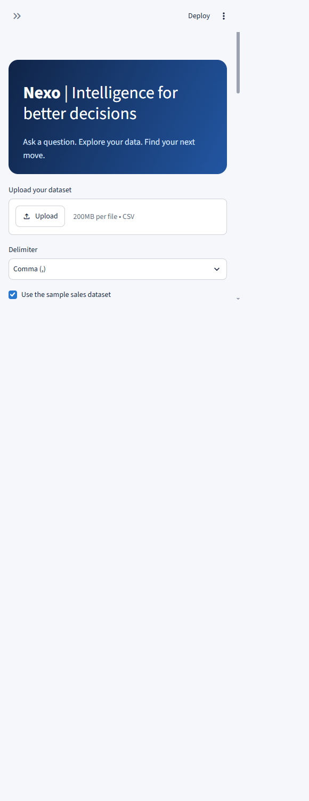
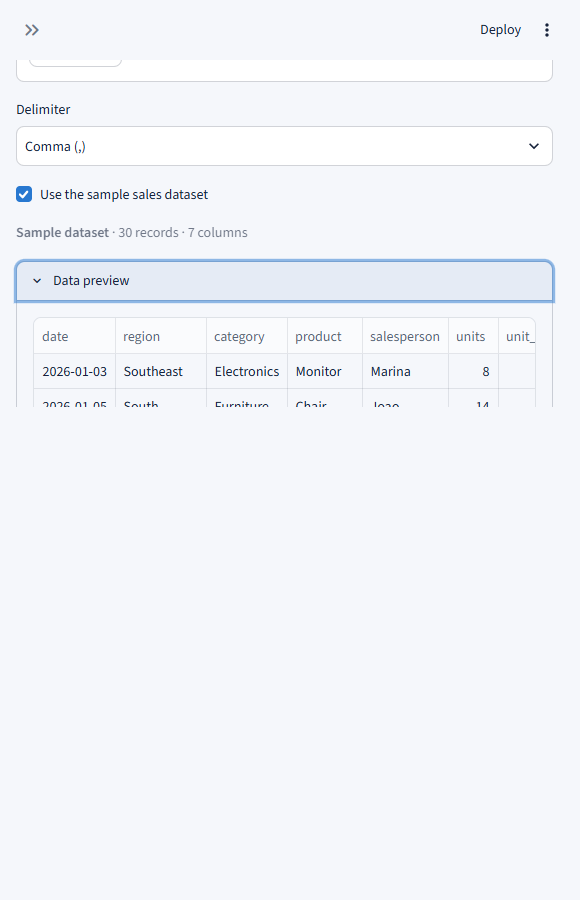
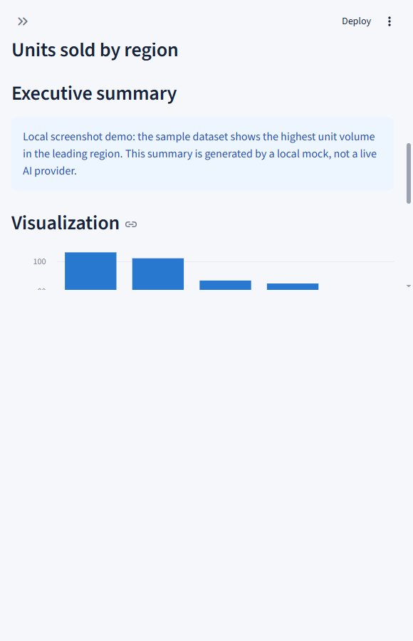
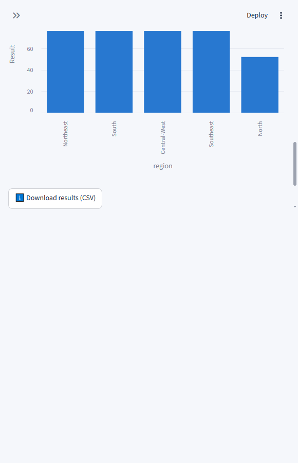
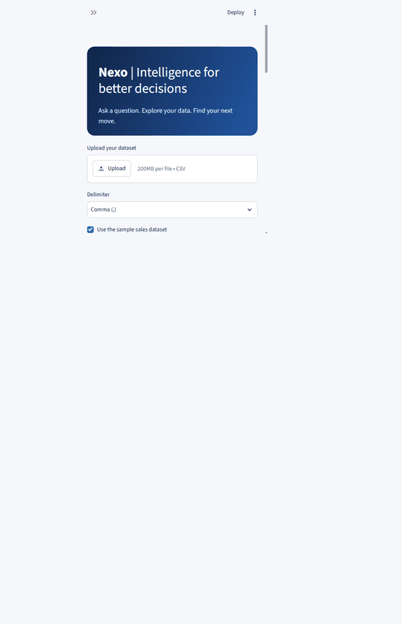
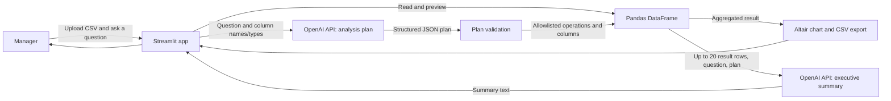

# Nexo — AI-Powered Analytics Dashboard

Ask questions about a CSV in plain English and turn the answers into a chart and
an executive summary. Nexo is a Streamlit proof of concept for helping managers
explore operational and sales data without writing queries or building each
report by hand.

> **Deployment status:** Nexo is not publicly deployed yet. There is no active
> Nexo demo URL to test. The Streamlit Community Cloud link below opens the
> deployment platform, not this application. A live app link can only be added
> after the source is pushed to a GitHub repository and deployed.

**Source repository:** [github.com/JCmamoa/Dash-IA](https://github.com/JCmamoa/Dash-IA)

## The business problem

Managers often depend on an analyst or a spreadsheet specialist to answer
questions such as:

- Which regions sold the most units in the sample dataset?
- What was the average order value by category?
- How many records are in each delivery status?
- Are two numeric measures moving together?

That workflow can involve cleaning a file, building a pivot table, choosing a
visualization, and writing a summary. It slows down everyday decisions and makes
ad-hoc analysis harder to repeat.

## What Nexo solves

Nexo lets a user upload a CSV, ask a question in natural language, and receive a
validated analysis plan, a locally calculated result, a visualization, and an
AI-generated executive summary. The model chooses from supported operations;
Pandas performs the calculations. The application does **not** execute
model-generated Python or SQL.

### Current capabilities

- Upload CSV files and select comma or semicolon delimiters.
- Preview the first eight records before asking a question.
- Explore the included sales sample without uploading a file.
- Analyze grouped sums, averages, medians, minimums, maximums, and counts.
- Render bar, line, pie, scatter, histogram, table, or single-value metric views.
- Generate an executive summary based on the calculated result.
- Download grouped results as CSV.
- Validate the requested columns, aggregation, chart type, and result limit.
- Require user authorization before sending analysis context to the OpenAI API.

## Product screenshots

These screenshots and the animated walkthrough were captured from the running
Streamlit application with the included synthetic sales dataset. The
chart-and-summary view used a local OpenAI-compatible mock so the UI could be
tested without an API key; the mock explicitly labels its response in the
screenshot. It demonstrates the application flow, **not a live OpenAI analysis
or a public deployment**. No customer data or credentials are shown.











The local demo does not replace screenshots and end-to-end verification from
the public deployment; add those after a live app URL is available.

## Impact: time saved

The application has not been run in a production pilot. Therefore, **there are
no measured time-savings or adoption results to claim yet**. The values below
are an illustrative planning scenario, not measured outcomes or a guarantee.

| Planning assumption | Example value |
|---|---:|
| Manual time to prepare one recurring analysis | 30 minutes |
| Time to ask, review, and export the same analysis in Nexo | 8 minutes |
| Analyses per manager per week | 3 |
| Managers in the example team | 8 |
| Estimated time saved per analysis | 22 minutes |
| Estimated team time saved per month | **about 38 hours** |

Calculation: `(30 - 8) minutes × 3 analyses/week × 8 managers × 4.33 weeks/month ÷ 60`.

### How to measure actual impact

Run a time-boxed pilot with representative users and comparable questions.
Record the end-to-end time for both workflows, including validation and review.
Use:

```text
Hours saved =
  (baseline minutes per analysis - Nexo minutes per analysis)
  × completed analyses
  × participating users
  ÷ 60
```

Track at least:

- Median time per completed analysis in both workflows.
- Number of analyses completed and number of active users.
- Percentage of AI plans accepted without correction.
- Percentage of results that need manual correction.
- User-rated usefulness and confidence in the summary.

Report the sample size, measurement period, and baseline alongside any future
impact figure. Time saved is not the same as cash savings or increased revenue.

## Architecture



### Components and data flow

| Component | Responsibility |
|---|---|
| `app.py` | Streamlit UI, file upload, session state, chart rendering, and downloads. |
| `ai.py` | OpenAI requests for structured analysis plans and executive summaries. |
| `analysis.py` | Plan validation, column/type checks, and Pandas aggregations. |
| Pandas | Reads the CSV and performs analysis in the Streamlit process. |
| Altair | Renders interactive visualizations in the dashboard. |
| OpenAI API | Interprets the question and writes a summary from aggregated results. |

The CSV is read and analyzed in the Streamlit app. With the user's explicit
consent, the question and column names/types are sent to OpenAI to create the
plan. The summary request includes the question, plan, row count, and up to 20
result rows. The complete CSV and its full rows are not intentionally sent to
the API. Review the data-handling requirements of your deployment and AI
provider before using confidential or regulated data.

### Technology stack

- Python 3.10+
- Streamlit
- Pandas
- Altair
- OpenAI API (`gpt-4o-mini` by default)
- `unittest` for analysis validation and aggregation tests

## Try the application

### Active public demo

**No active public Nexo demo is available yet.** This project directory is not
connected to a Git remote, and no deployment has been configured. We will not
provide a fabricated application URL.

- [Open Streamlit Community Cloud](https://share.streamlit.io/) — deployment
  platform only; it is **not** a link to a running Nexo demo.
- To provide a direct test link, deploy the application and replace this notice
  with the generated `https://<app-name>.streamlit.app` URL.

### Run locally

Requires Python 3.10 or later and an OpenAI API key:

```powershell
py -m venv .venv
.\.venv\Scripts\Activate.ps1
pip install -r requirements.txt
$env:OPENAI_API_KEY = "your-api-key"
streamlit run app.py
```

Optionally set `OPENAI_MODEL` to select another model. The default is
`gpt-4o-mini`.

## Deploy to Streamlit Community Cloud

1. Push the project to a GitHub repository.
2. In [Streamlit Community Cloud](https://share.streamlit.io/), create an app
   from that repository and set `app.py` as the entry point.
3. Add the API key under the app's **Settings → Secrets**:

   ```toml
   OPENAI_API_KEY = "your-api-key"
   ```

4. Deploy the app, verify a sample question end-to-end, and add the resulting
   `https://<app-name>.streamlit.app` URL to **Active public demo** above.
5. Capture real screenshots and a short GIF of the deployed app and add them to
   `docs/media/`.

Never commit API keys, Streamlit secrets, or private datasets to the repository.

## Privacy and limitations

- Analysis requires user consent to send the question, column names/types, and
  aggregate results to the OpenAI API.
- The uploaded CSV is processed by the Streamlit application; avoid sensitive
  data unless your security, privacy, and compliance reviews permit it.
- Individual chart points are not sent for histogram or scatter summaries;
  those summaries use local descriptive statistics. Other summaries receive at
  most 20 aggregated result rows.
- AI plans are restricted to supported aggregations and chart types, then
  checked against the available columns before execution.
- Summaries are generated from the returned results and may still require
  human review before being used for business decisions.
- CSV type inference, large files, date-specific questions, filters, and
  multi-step analysis may require additional handling; the current prototype
  does not support arbitrary SQL, custom Python, or general-purpose filtering.
- A deployed Streamlit app that uses a shared API key may incur API costs.
  Configure appropriate usage limits and monitor provider billing.

## Tests

Run the unit tests from the project root:

```powershell
py -m unittest discover -s tests -v
```

The tests cover grouped aggregation ordering, total row counts, unknown-column
rejection, and numeric metric validation.

## Project structure

```text
.
├── .streamlit/
│   └── config.toml
├── ai.py
├── analysis.py
├── app.py
├── docs/
│   └── media/
│       ├── dashboard-analysis-form.png
│       ├── dashboard-analysis-result.png
│       ├── dashboard-executive-summary.png
│       ├── dashboard-overview.png
│       └── nexo-analysis-walkthrough.gif
├── requirements.txt
├── sample_data/
│   └── sales.csv
└── tests/
    └── test_analysis.py
```
